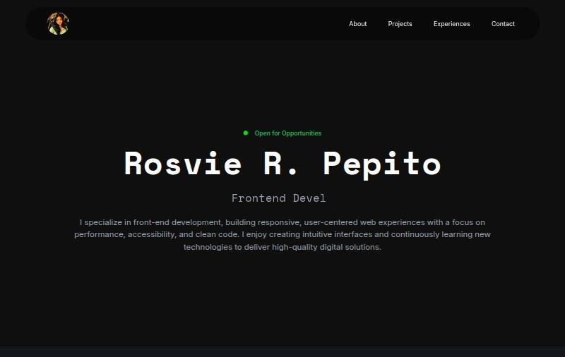

# Rosvie Pepito — Portfolio

My personal portfolio as a Frontend & WordPress Developer: projects, work experience and contact details.

**[▶ Live site: rosvie-dev.vercel.app](https://rosvie-dev.vercel.app/)**



## Features

- Responsive single-page layout with a fixed, frosted-glass navigation bar
- Typing-effect hero that cycles through my roles
- Projects grid with live demo and source links for each project
- Work experience carousel built from scratch: infinite auto-scroll, hover to pause, wheel and swipe momentum, and arrow buttons on mobile
- Contact section with email, LinkedIn and GitHub links

## Tech

Next.js · React · TypeScript · Tailwind CSS · Vercel

## Run it locally

```bash
npm install
npm run dev
```

Then open <http://localhost:3000>.
